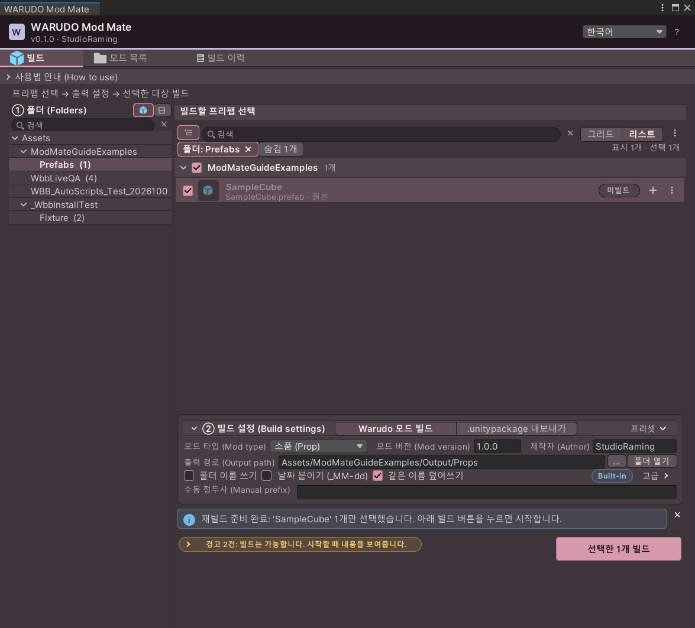
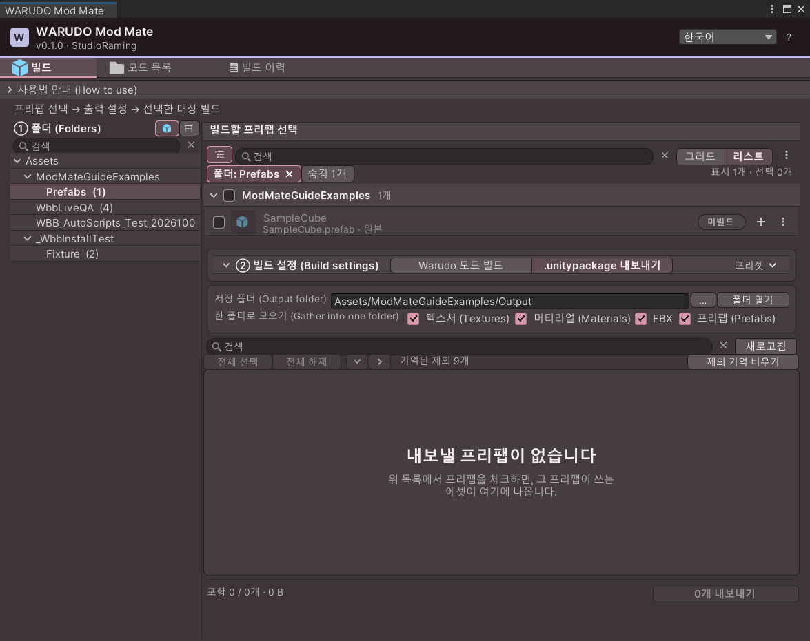
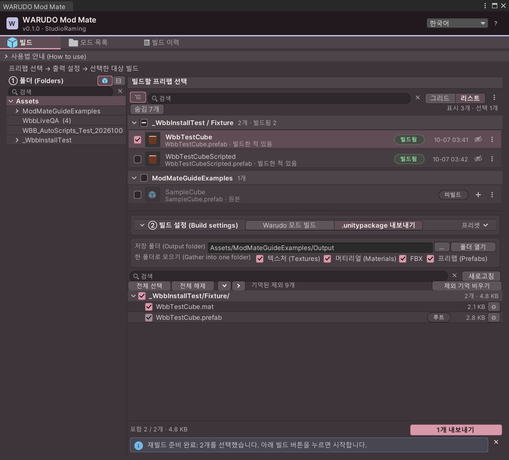
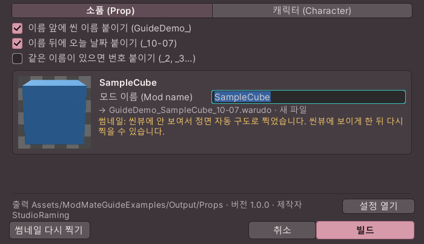
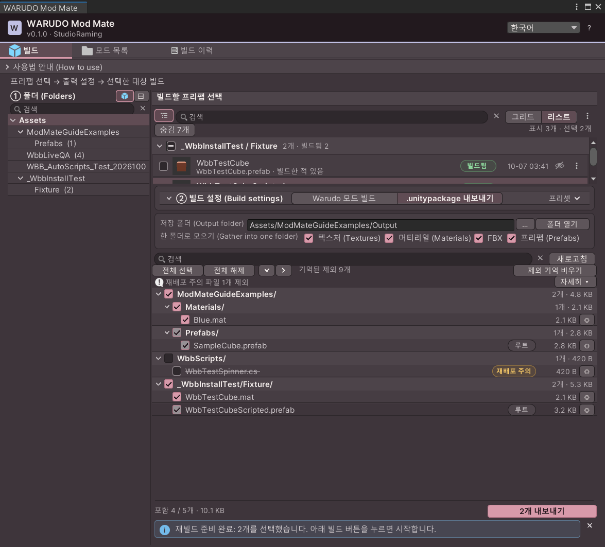
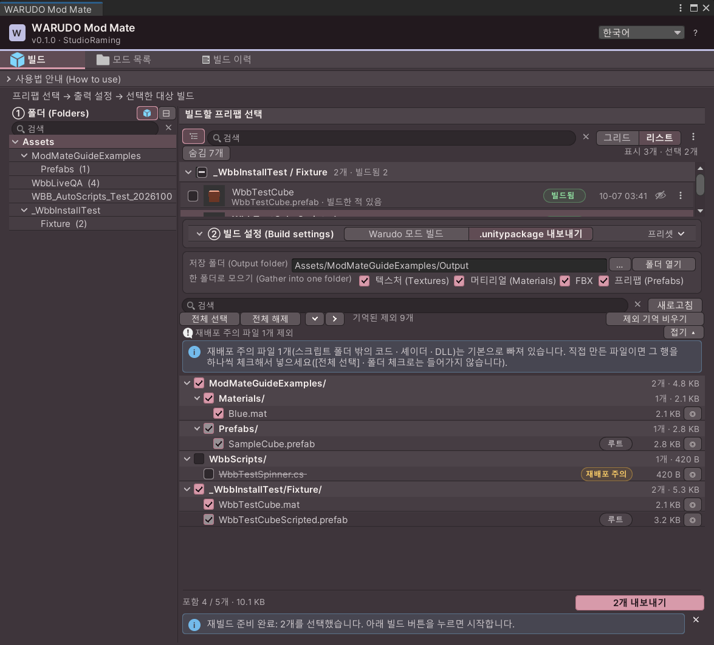
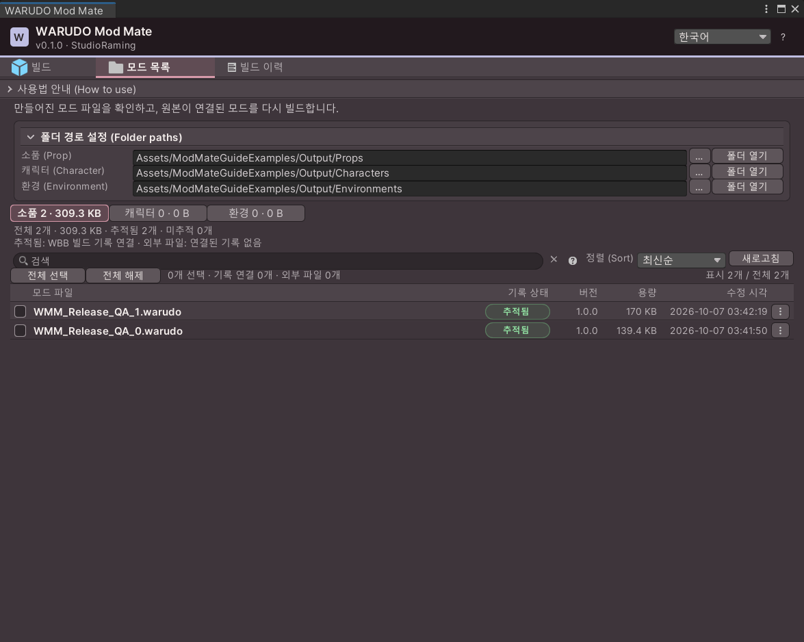
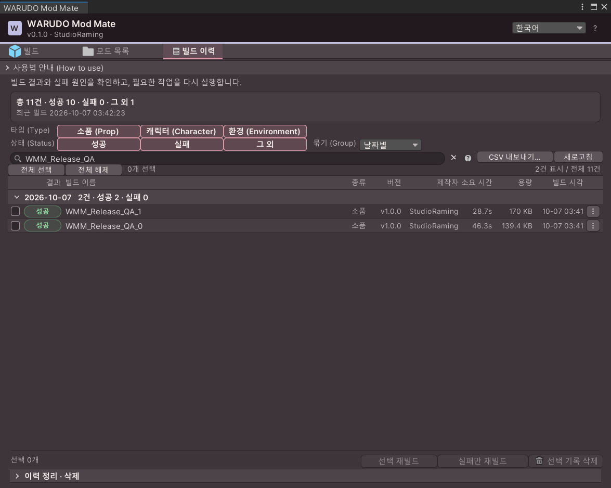

# WARUDO Mod Mate 0.1.2 — User guide

[한국어](#한국어) · [English](#english) · [日本語](#日本語)

## 한국어

[English](#english) | **한국어** | [日本語](#日本語)

**프리팹을 선택하고 한 번에 빌드하는 무료 와루도 모딩 도우미입니다.** 매번 원본 이름을 바꾸고 폴더를 옮기는 반복 작업을 줄이고, 씬 오브젝트 빠른 빌드·빌드 이력·Unity 패키지 내보내기를 한 창에서 관리합니다.

**[유니티패키지 바로 다운로드](https://github.com/StudioRaming/WARUDO-Mod-Mate/releases/latest/download/WARUDO_Mod_Mate_0.1.2.unitypackage)** · [전체 릴리스](https://github.com/StudioRaming/WARUDO-Mod-Mate/releases) · [MIT 라이선스](LICENSE.txt)

다운로드한 파일을 Unity에 임포트하면 됩니다. 소스를 직접 컴파일할 필요는 없습니다. 아래 화면은 0.1.0을 실제 Unity 에디터에서 열어 캡처한 것입니다. 캡처에 사용한 큐브·폴더·빌드 이력은 설명용 예제이며 배포 패키지에는 포함하지 않습니다.

## 목차

1. [무엇을 할 수 있나요?](#무엇을-할-수-있나요)
2. [준비물](#준비물)
3. [설치하기](#설치하기)
4. [처음 써 보기: 큐브 하나 빌드](#처음-써-보기-큐브-하나-빌드)
5. [빌드 화면 읽는 법](#빌드-화면-읽는-법)
6. [목록 높이 조절](#목록-높이-조절)
7. [씬 오브젝트 빠른 빌드](#씬-오브젝트-빠른-빌드)
8. [unitypackage로 내보내기](#unitypackage로-내보내기)
9. [모드 목록과 빌드 이력](#모드-목록과-빌드-이력)
10. [문제가 생겼을 때](#문제가-생겼을-때)
11. [업데이트·문의·라이선스](#업데이트문의라이선스)

## 무엇을 할 수 있나요?

| 하고 싶은 일 | 사용할 기능 | 얻는 결과 |
| --- | --- | --- |
| 여러 소품 프리팹을 차례로 빌드 | 빌드 탭에서 여러 항목 선택 → 선택 대상 빌드 | 프리팹별 `.warudo` 파일과 결과 기록 |
| 준비된 캐릭터 프리팹 빌드 | 모드 타입을 캐릭터로 설정 | 캐릭터 모드 파일 |
| 씬에서 만든 오브젝트를 빠르게 시험 | Hierarchy 우클릭 → WARUDO Mod Mate → Prop / Character | 현재 오브젝트를 임시 복사본으로 빌드 |
| 전에 만든 결과 찾기·다시 빌드 | 모드 목록 / 빌드 이력 | 파일 확인, 연결된 소스 찾기, 재빌드 준비 |
| 프리팹과 필요한 에셋을 다른 Unity 프로젝트로 전달 | `.unitypackage 내보내기` | 프리팹별 Unity 패키지 |

0.1.x는 **Prop·Character 프리팹 빌드와 Unity 패키지 내보내기**를 제공합니다. 환경(Environment)의 프리팹 일괄 빌드는 사전 점검에서 차단합니다. 환경 제작은 [공식 환경 모드 안내](https://docs.warudo.app/docs/modding/environment-mod)를 사용하세요. 모드 목록에서는 이미 만들어진 환경 모드 파일을 확인할 수 있습니다.

Live Test, 아바타 리깅, 자동 셰이더 변환, 물리 세팅은 포함하지 않습니다. 캐릭터가 SDK에 맞게 준비되어야 하며, 모드 종류를 캐릭터로 고르는 것만으로 리깅이나 물리가 만들어지지는 않습니다.

## 준비물

| 준비물 | 언제 필요한가요? |
| --- | --- |
| Windows PC와 Unity **2021.3.45f2** | 검증된 사용 환경입니다. 비슷한 버전 번호 대신 정확한 `f2`를 확인하세요. |
| WARUDO Mod Tool SDK | `.warudo`를 만들 때 필요합니다. 도구 패키지에 SDK는 들어 있지 않습니다. |
| WARUDO와 호환되는 프리팹·머티리얼·셰이더 | 실제 모드의 내용입니다. |
| WARUDO | 만든 모드를 실제로 불러와 확인할 때 필요합니다. 자동 스크립트 모드로 빌드할 때도 같은 PC에 WARUDO가 있어야 합니다(Steam 자동 감지, 출력 경로, 또는 지정한 WARUDO 폴더). |

`.unitypackage` 내보내기만 사용한다면 WARUDO SDK 없이 도구를 설치할 수 있습니다.

제품 설치·빌드 검증의 SDK 기준은 **0.14.3.10**입니다. 공식 설치 페이지에서 현재 배포되는 SDK 버전과 이 검증 기준은 구분해 주세요. 다른 SDK 버전을 사용할 때는 별도 프로젝트에서 먼저 시험하는 것을 권합니다.

## 설치하기

### 1. 프로젝트 준비

Unity Hub에서 **2021.3.45f2** 프로젝트를 엽니다. 기존 작업 프로젝트를 사용할 경우 임포트 전 프로젝트를 백업해 두세요.

`.warudo` 제작이 처음이라면 [공식 SDK 설치 안내](https://docs.warudo.app/docs/modding/sdk-installation)를 따라 SDK를 준비합니다. **Edit → Project Settings → Player → Other Settings**에서 API Compatibility Level은 **.NET Framework**, Assembly Version Validation은 **해제** 상태로 확인합니다. SDK 설치가 끝난 뒤 Console에 빨간 컴파일 오류가 없어야 합니다.

### 2. Mod Mate 패키지 임포트

1. 맨 위의 **유니티패키지 바로 다운로드**를 누릅니다.
2. Unity에서 **Assets → Import Package → Custom Package…**를 선택합니다.
3. `WARUDO_Mod_Mate_0.1.2.unitypackage`를 선택합니다.
4. 항목 목록을 확인하고 **Import**를 누릅니다. 제품 폴더 안의 코드·매뉴얼·이미지는 함께 임포트하세요.
5. 컴파일이 끝날 때까지 기다립니다.
6. **StudioRaming → WARUDO Mod Mate**를 엽니다.

창 위에 **v0.1.2**가 보이면 이번 버전이 열린 것입니다. 메뉴가 없다면 먼저 Console의 컴파일 오류를 확인하세요.

자동 새로고침을 꺼둔 프로젝트라면 **Assets → Refresh**로 가져오기를 갱신한 뒤 컴파일 완료를 기다리세요. 파일을 교체했어도 컴파일 전에는 이전 버전의 창이 표시될 수 있습니다.

### 3. SDK 모드 빌드 설정 준비

SDK가 있는 프로젝트에서도 모드 빌드 설정이 없으면 `.warudo` 제작이 차단됩니다. **Warudo → New Mod**로 SDK의 기본 모드 설정을 준비하세요(빌드 탭의 **빌드 설정 만들기** 버튼으로도 만들 수 있습니다). 상세 절차는 [공식 첫 모드 제작 안내](https://docs.warudo.app/docs/modding/creating-your-first-mod)에 있습니다. Mod Mate는 빌드할 때 이 설정을 사용하고 작업 뒤 원래 설정으로 복원합니다.

## 처음 써 보기: 큐브 하나 빌드

큰 캐릭터를 바로 넣기 전에 작은 프리팹 하나로 설치 상태를 확인하면 문제를 찾기 쉽습니다.

1. Unity에서 **GameObject → 3D Object → Cube**를 만듭니다.
2. Project 창에 예제 폴더를 만들고 큐브를 드래그해 프리팹으로 저장합니다.
3. 씬과 프리팹을 의도한 상태로 저장합니다.
4. Mod Mate의 **빌드** 탭을 엽니다.
5. 왼쪽 **① 폴더**에서 프리팹이 있는 폴더를 고릅니다.
6. 오른쪽 목록에서 큐브의 체크박스를 켭니다.
7. **② 빌드 설정**에서 **Warudo 모드 빌드**, 모드 타입 **소품(Prop)**을 선택합니다.
8. 제작자와 모드 버전, 출력 경로를 확인합니다. 처음에는 프로젝트 안의 별도 시험 폴더로 출력하면 결과를 구분하기 쉽습니다.
9. 목록에 표시된 **최종 모드 이름**을 확인합니다. 폴더 이름·날짜 옵션을 켜면 프리팹 파일 이름과 달라질 수 있습니다.
10. 사전 점검을 확인한 뒤 **선택한 1개 빌드**를 누릅니다.
11. 완료 후 출력 폴더와 **빌드 이력**을 확인합니다.

정상 결과는 `.warudo` 파일과 성공 기록입니다. 이후 WARUDO에서 해당 소품을 불러와 실제로 보이는지 확인하세요. 데이터 폴더의 `Props`와 `Characters` 구분 및 Source 선택은 위 공식 첫 모드 안내를 참고하면 됩니다.

**툴 버전과 모드 버전은 다릅니다.** 창 위의 `v0.1.2`는 Mod Mate 버전이고, 빌드 설정의 `모드 버전`은 지금 만드는 모드의 버전입니다. 이 값에 `1.0.0`이 보여도 툴이 잘못 설치된 것은 아닙니다.

## 빌드 화면 읽는 법

### ① 폴더와 프리팹 목록

폴더를 선택하면 해당 범위의 프리팹이 나타납니다. 검색으로 목록을 좁히고 체크박스로 빌드할 대상을 선택합니다. 목록·그리드 보기와 정렬, 묶음 펼치기·접기를 사용할 수 있습니다.

흐리게 보이는 항목은 일반 작업 대상과 구분된 항목입니다. 필요한 프리팹이 보이지 않을 때는 폴더 범위·검색·숨김 여부와 새로고침을 먼저 확인하세요. 무조건 프로젝트 전체를 선택해 빌드하지 말고, 최종 선택 수와 모드 이름을 확인합니다.

### ② 빌드 설정

| 항목 | 의미와 확인할 것 |
| --- | --- |
| 모드 타입 | 소품은 Prop, 준비된 캐릭터는 Character. 환경 프리팹 빌드는 지원하지 않습니다. |
| 모드 버전 | 만드는 모드의 버전입니다. 툴 버전과 별개입니다. |
| 제작자 | 모드에 기록할 제작자 이름입니다. |
| 출력 경로 | 결과가 저장될 폴더입니다. 다른 프로젝트에서 사용한 경로가 남을 수 있으므로 매번 확인하세요. |
| 폴더 이름 쓰기 / 날짜 붙이기 | 최종 파일 이름에 영향을 줍니다. 목록에서 결과 이름을 확인합니다. |
| 같은 이름 덮어쓰기 | 기존 결과를 갱신할 때 사용합니다. 빌드 전 기존 출력 백업과 실패 시 복원이 적용됩니다. |
| Built-in / URP 표시 | 현재 Unity 프로젝트의 렌더 파이프라인입니다. WARUDO의 설정과 맞춰야 합니다. 옆의 WARUDO 배지는 WARUDO 값(URP/NiloToon 활성화됨)을 보여 주고, 다르면 경고로 표시합니다. 빌드는 막지 않습니다. |
| 프리셋 | 반복해서 사용하는 빌드 설정을 불러올 때 사용합니다. 적용 후 경로·제작자·대상은 다시 확인하세요. |

### 고급 설정과 스크립트

고급을 펼치면 설명, 스크립트 폴더 직접 지정, VRChat 전용 컴포넌트 제외 등의 설정을 확인할 수 있습니다.

- 기본은 **런타임 스크립트 자동 수집**입니다. 프리팹과 참조가 실제로 사용하는 소스를 계산합니다. Editor 전용 코드와 WARUDO가 제공하는 타입은 중복 포함하지 않습니다.
- **스크립트 폴더 직접 지정**은 필요한 소스를 수동으로 관리할 때 사용하는 고급 옵션입니다. 단순 프리팹 테스트부터 성공시킨 뒤 사용하세요.
- **런타임 코드 컴파일**: 모드에 들어갈 일반 스크립트와 어셈블리 정의(.asmdef) 중 Unity가 플레이어용으로 컴파일하는 것은 Mod Mate가 직접 DLL로 컴파일해 모드에 넣습니다. 기본인 **런타임 스크립트 자동 수집**은 프리팹이 쓰는 스크립트를 위치와 관계없이 모으고, **스크립트 폴더 직접 지정**을 켜면 그 폴더의 스크립트(하위 폴더 포함)만 씁니다. UMod 이 느슨한 스크립트를 컴파일하면 Warudo.Core 같은 어셈블리와 타입이 맞지 않아 실패하기 때문입니다. Editor 폴더의 스크립트와 Editor 전용·테스트 어셈블리는 제외합니다. 폴더를 직접 지정했을 때 폴더 밖에 있는 코드를 쓰면 컴파일 오류로 알려 주니 그 스크립트를 폴더 안으로 옮기세요. WARUDO가 제공하지 않는 어셈블리를 참조하면 사전 점검이 막고, 코드 보안 검사가 거부하면 거부된 API 목록을 결과에 보여 줍니다.
- **VRChat 전용 컴포넌트 빼고 굽기**는 빌드용 복사본의 VRChat 전용 요소를 정리하는 옵션입니다. 원본 프리팹은 보존합니다. WARUDO 물리를 자동으로 설정하는 옵션은 아닙니다.
- 외부 DLL, 동적 로딩, 모든 타사 플러그인이 자동으로 호환되는 것은 아닙니다. 오류가 나면 해당 모듈의 WARUDO 지원을 확인하세요.

### 사전 점검·진행·중단

빨간 차단 항목은 해결해야 빌드를 시작할 수 있습니다. 노란 경고는 내용 확인 후 진행 가능한 경우가 있습니다. 안내를 펼치거나 툴팁을 읽어 원인을 확인하세요.

빌드는 한 항목씩 진행됩니다. 진행 표시와 로그로 현재 단계를 확인합니다. 중단을 요청하면 처리 중인 항목이 마무리된 뒤 남은 작업을 멈추는 경우가 있습니다. 즉시 모든 처리가 종료됐다고 생각하지 말고 완료 상태를 기다리세요.

빌드 전 씬과 프리팹을 먼저 저장하세요. SDK 빌드 과정에서는 이름이 있는 변경된 씬이 저장될 수 있습니다. 이름 없는 새 씬이나 저장되지 않은 Prefab 편집은 사전 점검에서 막힐 수 있습니다.

## 목록 높이 조절

위 **프리팹 목록**과 아래 **빌드 설정** 사이의 가로 경계에 마우스를 올리면 높이 조절 커서가 나타납니다.

- 경계를 **위로 드래그**하면 아래 빌드 설정·내보내기 영역이 넓어집니다.
- 경계를 **아래로 드래그**하면 위 프리팹 목록이 넓어집니다.
- **두 번 클릭**하면 자동 높이로 돌아갑니다.
- 조절한 높이는 Warudo 모드 빌드와 Unity 패키지 내보내기 모드에서 각각 기억합니다.

목록이 길면 목록 안에서 휠로 스크롤합니다. 작은 창에서는 내보내기 화면 전체도 스크롤할 수 있어 하단 버튼에 접근할 수 있습니다. 창을 키우면 아래 에셋 목록이 남은 공간을 더 사용합니다.

## 씬 오브젝트 빠른 빌드

1. Hierarchy에서 빌드할 **씬 오브젝트**를 선택합니다.
2. 우클릭 → **WARUDO Mod Mate → Prop** 또는 **Character**를 선택합니다. 상단 **GameObject** 메뉴에도 같은 항목이 있습니다.
3. 빠른 빌드 창에서 대상과 모드 이름을 확인합니다.
4. 같은 이름이 겹치면 이름을 바꾸거나 번호 붙이기를 사용합니다.
5. 버전·제작자·출력 폴더는 메인 빌드 설정을 따릅니다. 필요하면 설정 창으로 이동해 확인합니다.
6. 빌드하고 이력·출력 파일을 확인합니다.

씬의 현재 오브젝트 상태를 임시 복사본으로 빌드합니다. 프로젝트의 프리팹을 영구 이동하거나 씬 오브젝트 이름을 강제로 바꿔 작업하는 방식이 아닙니다. 물리·셰이더·캐릭터 설정 자체는 미리 준비해야 합니다.

메뉴가 꺼져 있다면 씬 오브젝트를 선택했는지, Play Mode인지, 다른 빌드가 진행 중인지 확인하세요. Project 창의 에셋 선택과 Hierarchy의 씬 오브젝트 선택은 다릅니다.

## unitypackage로 내보내기

`.warudo`는 WARUDO에서 사용하는 결과이고, `.unitypackage`는 다른 Unity 프로젝트로 에셋을 옮길 때 사용하는 파일입니다.

1. 위 프리팹 목록에서 전달할 프리팹을 선택합니다.
2. **② 빌드 설정 → .unitypackage 내보내기**를 선택합니다.
3. 저장 폴더를 지정합니다.
4. 아래 에셋 목록에서 프리팹이 사용하는 머티리얼·텍스처·모델 등을 확인합니다.
5. 필요한 경우 **한 폴더로 모으기**의 텍스처·머티리얼·FBX·프리팹 옵션을 고릅니다. 끄면 원래 경로 구조를 사용하는 방식으로 확인할 수 있습니다.
6. 최종 포함 수와 재배포 주의 표시를 확인합니다.
7. **내보내기**를 눌러 결과 폴더를 확인합니다. 여러 프리팹을 선택하면 프리팹별 패키지를 만듭니다.

`루트`로 표시된 선택 프리팹은 필수 포함 항목이라 해제할 수 없습니다. 검색은 보이는 목록을 좁히는 기능입니다. 목록 일부만 보고 판단하지 말고 포함 수와 대상 프리팹 수를 확인하세요.

### 재배포 주의 안내

스크립트 폴더 밖의 코드·셰이더·DLL 같은 주의 파일은 기본 제외될 수 있습니다. 한 줄 요약의 **자세히**를 누르거나 툴팁으로 이유를 확인합니다.

**전체 선택이나 폴더 체크만으로 주의 파일이 자동 포함되지는 않습니다.** 직접 제작했거나 재배포가 허용된 파일만 개별 행에서 포함하세요. Mod Mate의 MIT 라이선스가 아바타·의상·셰이더·SDK의 재배포 권한까지 주지는 않습니다.

## 모드 목록과 빌드 이력

### 모드 목록: 지금 있는 파일

**폴더 경로 설정**을 펼쳐 Prop·Character·Environment 폴더를 지정하고 새로고침합니다. 종류와 검색으로 목록을 좁힐 수 있습니다.

파일을 찾았다는 것과 빌드 이력에 연결됐다는 것은 별개입니다. 외부에서 만든 파일이나 복사·이동한 파일은 이력과 연결되지 않을 수 있습니다. 연결된 소스가 있는 항목만 재빌드할 수 있습니다.

폴더 열기·경로 복사로 실제 위치를 확인하세요. 삭제 기능은 실제 모드 파일을 대상으로 하므로 선택한 파일 이름과 경로를 확인한 뒤 사용합니다.

### 빌드 이력: 무엇을 했는지

성공·실패·그 외 기록을 확인하고 종류·상태·검색으로 필터링합니다. 날짜별·프리셋별·평면 묶음으로 볼 수 있습니다.

행 메뉴에서는 재빌드, 출력 폴더 열기, 경로 복사, 로그 보기 등을 사용할 수 있습니다. 재빌드는 대상을 메인 빌드 탭에 준비한 뒤 다시 빌드 버튼으로 시작하는 흐름입니다. 설정이 다른 요청은 별도 묶음으로 다룰 수 있으므로 안내를 읽어 주세요.

**파일 없음**은 새로고침 시 결과 파일을 찾지 못했다는 표시입니다. 이력의 성공 기록이 있어도 파일이 이동·삭제됐다면 현재 파일은 없을 수 있습니다. 반대로 파일이 있어도 실제 WARUDO에서 정상 동작한다는 확인은 별도로 필요합니다.

**실패만 재빌드**는 중복을 줄여 최신 실패 대상을 준비합니다. 기록을 보관하려면 CSV 내보내기를 사용하세요. 이력 기록 삭제와 실제 `.warudo` 파일 삭제는 다른 작업입니다.

## 문제가 생겼을 때

| 증상 | 먼저 확인할 것 | 다음 행동 |
| --- | --- | --- |
| 메뉴가 안 보임 | Console에 빨간 컴파일 오류가 있는지 | 가장 먼저 발생한 오류부터 해결하고 재확인 |
| SDK가 없다는 안내 | WARUDO Mod Tool 설치 여부 | SDK 설치 후 컴파일 완료까지 기다림 |
| 모드 빌드 설정을 찾지 못함 | SDK 모드 설정 생성 여부 | Warudo → New Mod 및 공식 첫 모드 안내 확인 |
| `.NET`·Reflection 관련 SDK 컴파일 오류 | API Compatibility Level / Assembly Version Validation | .NET Framework / 해제 상태 확인 |
| 목록이 비어 있음 | 폴더 범위·검색·숨김·인덱스 진행 | 검색 초기화, 폴더 재선택, 새로고침 |
| 빌드 버튼이 꺼짐 | 선택 수·사전 점검·진행 중 작업 | 차단 항목 해결 후 대상 확인 |
| 환경 빌드가 차단됨 | Environment 타입인지 | 0.1.x의 지원 범위는 Prop·Character 프리팹. 공식 SDK 환경 제작 흐름 사용 |
| 빠른 빌드 메뉴가 꺼짐 | Hierarchy 선택 / Play Mode / 다른 빌드 | 씬 오브젝트를 선택하고 빌드 종료까지 기다림 |
| 결과 이름이 예상과 다름 | 이름 편집·폴더 이름·날짜 옵션 | 목록의 최종 이름을 빌드 전에 확인 |
| 아래 목록이 좁음 | 상하 분할 경계·창 높이 | 경계를 위로 드래그, 휠 스크롤, 필요하면 창 확대 |
| 빌드가 멈춘 것처럼 보임 | 셰이더·스크립트 컴파일 / 현재 로그 | 진행 로그 확인. 같은 항목을 반복 시작하지 않음 |
| 캐릭터가 보이지 않거나 마젠타 | Unity와 WARUDO의 렌더 파이프라인·셰이더 | Built-in/URP 일치(WARUDO 배지 확인) 및 셰이더 호환 확인 |
| 자동 수집 스크립트가 실패 | 해당 스크립트의 컴파일 오류·외부 의존성 | 작은 대상부터 시험하고 필요한 의존성의 WARUDO 지원 확인 |
| 중단 뒤 원본 또는 출력 복구 안내 | 현재 작업이 완전히 끝났는지·복구 메시지 | 안내된 폴더/백업을 확인. 메시지와 로그를 보관하고 문의 |
| 빌드 도중 Unity가 스크립트를 다시 컴파일해 멈춤 | 빌드 탭 상단 안내·빌드 이력의 항목 메시지 | 설정은 자동 복원됩니다. 스크립트 편집이 끝난 뒤 해당 항목만 다시 빌드 |

## 자주 묻는 질문

**프리팹 이름을 Prop나 Character로 바꿔야 하나요?** 원본 프리팹 이름을 직접 바꾸지 않고 Mod Mate에서 타입을 고릅니다. SDK에 전달할 빌드용 복사본은 도구가 준비합니다.

**여러 프리팹을 한 파일에 합치나요?** 일반 일괄 빌드는 프리팹마다 결과를 만듭니다. 한 모드에 묶을 구성은 먼저 하나의 프리팹으로 준비하세요.

**빌드 성공이면 WARUDO에서 검증도 끝난 건가요?** 아닙니다. 성공은 빌드·출력 확인 결과입니다. WARUDO에서 로드·렌더·물리·스크립트 동작을 확인하는 단계가 남습니다.

**SDK 없이 쓸 수 있나요?** Unity 패키지 내보내기는 가능합니다. `.warudo` 제작에는 SDK가 필요합니다.

**자동 수집이면 스크립트를 모두 포함하나요?** 사용되는 소스와 관련 참조를 대상으로 합니다. SDK/WARUDO 제공 코드와 Editor 전용 코드는 제외하며, 모든 외부 DLL이나 타사 플러그인의 호환성을 보장하지 않습니다.

**다른 프로젝트의 출력 경로가 보이는 이유는요?** 일부 UI·출력 설정은 PC의 EditorPrefs에 기억됩니다. 프로젝트별 스크립트 폴더 설정과는 구분되므로 빌드 전 경로를 확인하세요.

**무료로 상업 작업에 써도 되나요?** Mod Mate는 MIT 조건에 따라 사용할 수 있습니다. 입력 에셋·SDK·플러그인의 라이선스는 따로 확인해야 합니다.

## 업데이트·문의·라이선스

최신 패키지를 받아 같은 제품 폴더로 임포트합니다. 내부 폴더 이름 **WarudoBatchBuilder**는 설정·이력 호환 때문에 유지합니다. 예전 폴더를 임의로 다른 이름으로 바꾸지 마세요. 업데이트 전 프로젝트 백업을 권합니다.

툴 상단 **? → 사용 가이드 · 화면별 설명**, **최신 패키지 다운로드**, **GitHub · 소스 코드**를 사용할 수 있습니다.

문의: **studioraming@gmail.com** 또는 [GitHub Issues](https://github.com/StudioRaming/WARUDO-Mod-Mate/issues).

문의할 때는 툴 버전, Unity·SDK 버전, Prop/Character/패키지 중 어느 작업인지, 재현 순서, 오류 로그를 알려 주세요. **? → 문의용 환경 정보 복사**를 사용하면 환경 확인에 도움이 됩니다. 개인 파일 경로나 에셋 내용이 포함됐는지 보내기 전에 확인하세요.

도구와 문서는 [MIT 라이선스](LICENSE.txt)로 공개합니다. StudioRaming의 독립 도구이며 WARUDO SDK·셰이더·아바타 등을 동봉하거나 그 라이선스를 대체하지 않습니다.

## English

**English** | [한국어](#한국어) | [日本語](#日本語)

**A free Unity Editor helper for building WARUDO mods from selected prefabs.** Batch-build prepared prefabs, quick-build scene objects, inspect earlier results and export prefab dependencies from one window.

**[Download the Unity package directly](https://github.com/StudioRaming/WARUDO-Mod-Mate/releases/latest/download/WARUDO_Mod_Mate_0.1.2.unitypackage)** · [All releases](https://github.com/StudioRaming/WARUDO-Mod-Mate/releases) · [MIT License](LICENSE.txt)

Import the downloaded package into Unity; no manual source compilation is required. The screenshots show the actual 0.1.0 Editor UI in Korean. The example cubes, folders and records are not included in the release package.

## Contents

1. [What it does](#what-it-does)
2. [Requirements and installation](#requirements-and-installation)
3. [First build: one cube](#first-build-one-cube)
4. [Understanding Build settings](#understanding-build-settings)
5. [Resize the two areas](#resize-the-two-areas)
6. [Quick-build a scene object](#quick-build-a-scene-object)
7. [Export a Unity package](#export-a-unity-package)
8. [Library and History](#library-and-history)
9. [Troubleshooting](#troubleshooting)
10. [FAQ, updates and support](#faq-updates-and-support)

## What it does

| Your task | Feature | Result |
| --- | --- | --- |
| Build several prepared props | Select prefabs in Build and start the batch | A `.warudo` file and result record per prefab |
| Build a prepared character | Choose Character as the mod type | A character mod file |
| Test an object assembled in a scene | Hierarchy → WARUDO Mod Mate → Prop / Character | A temporary-copy build of the current object |
| Find or rebuild an earlier result | Library / History | File lookup, source lookup and rebuild preparation |
| Transfer a prefab to another project | Unity package export | A package containing the prefab and selected dependencies |

0.1.x supports **Prop and Character prefab builds** and Unity package export. Environment prefab builds are blocked; follow the [official Environment Mod workflow](https://docs.warudo.app/docs/modding/environment-mod). Library can still list existing environment files.

Live Test, avatar rigging, automatic shader conversion and physics setup are not included. Choosing Character does not configure a rig or physics system.

## Requirements and installation

Use a Windows PC and Unity **2021.3.45f2**. Building `.warudo` requires the separately installed WARUDO Mod Tool SDK and compatible content. WARUDO is needed to load and test outputs. Auto script mode builds also need WARUDO on the same PC (Steam auto-detect, the output path, or a set WARUDO folder). Unity package export works without the SDK.

The tested SDK baseline is **0.14.3.10**. Other versions should be tried in a separate project. See the [official SDK installation guide](https://docs.warudo.app/docs/modding/sdk-installation). In **Player → Other Settings**, select **.NET Framework** API Compatibility Level and disable **Assembly Version Validation**. Wait until SDK import finishes without red Console errors.

### Import Mod Mate

1. Back up an existing project before importing.
2. Use the direct download link above.
3. Choose **Assets → Import Package → Custom Package…** in Unity.
4. Select `WARUDO_Mod_Mate_0.1.2.unitypackage` and import its code, manual and images together.
5. Wait for compilation and open **StudioRaming → WARUDO Mod Mate**.
6. Confirm **v0.1.2** in the header.

Missing menu? Resolve the first red Console compilation error first.

If Auto Refresh is disabled, use **Assets → Refresh** and wait for script compilation. Replaced source files can still show the older window until compilation finishes.

### Prepare export settings

An SDK installation may not yet have mod export settings. Prepare them through **Warudo → New Mod** or the **Create settings** button on the Build tab; see the [official first-mod tutorial](https://docs.warudo.app/docs/modding/creating-your-first-mod). Mod Mate temporarily uses these settings and restores them after a build.

## First build: one cube

Try a small prefab before a large character to separate installation issues from asset-specific issues.

1. Create a cube through **GameObject → 3D Object → Cube**.
2. Make an example Project folder and drag the cube into it to save a prefab.
3. Save your intended scene and prefab state.
4. Open **Build** and choose the prefab folder under **① Folders**.
5. Tick the cube.
6. Under **② Build settings**, choose **Build Warudo mod** and **Prop**.
7. Check author, mod version and output folder. A separate test folder makes first results easy to identify.
8. Inspect the final mod name in the list; folder-name and date options can change it.
9. Resolve blockers and click the button to build the selected prefab.
10. Inspect the output folder and **History**.

A successful result is a `.warudo` file and success record. Load it in WARUDO afterward to check rendering and behavior. The official first-mod tutorial explains Props/Characters folders and Source selection.

**Tool version and mod version differ.** The header's `v0.1.2` is Mod Mate's version. `Mod version` describes your output and may be `1.0.0`.

## Understanding Build settings

### Folders and selection

Choose a folder, narrow the list with search and tick targets. List/grid views, sorting and group expansion help with larger lists. If something is missing, check folder scope, search, hidden items and index progress, then refresh. Dimmed entries are distinguished from normal working targets. Check the final selection count and output names.

| Control | What to check |
| --- | --- |
| Mod type | Prop or prepared Character; Environment prefab builds are unsupported |
| Mod version / Author | Metadata for your output mod |
| Output path | Where files are written; paths from another project may remain |
| Folder name / date options | Affect final names shown in the list |
| Overwrite same name | Update an existing file, with backup and failed-build restoration |
| Built-in / URP badge | Current Unity pipeline; match WARUDO's setting. A second badge shows WARUDO's value (its URP/NiloToon Enabled option), and a mismatch is flagged as a warning without blocking the build |
| Presets | Reuse settings, then recheck paths, author and selection |

### Advanced settings and scripts

Advanced settings include description, manual script folders and leaving out VRChat-only components.

- Automatic runtime-script collection follows used sources and references. Editor-only code and WARUDO-provided types are excluded.
- Manual folders are an advanced source-management option. Start with a simple working prefab.
- Runtime code compile: the plain scripts and the assembly definitions (.asmdef) that the mod needs and that Unity compiles for the player are compiled by Mod Mate into DLLs and packed into the mod. With **Automatically collect runtime scripts** (the default) the scripts the prefab uses are gathered wherever they are; with **Specify the script folder manually** only the scripts of that folder (subfolders included) are used. UMod compiling loose scripts fails against assemblies such as Warudo.Core because the Unity types do not match. Scripts in Editor folders and Editor-only or test assemblies stay out. With a manual folder, code outside the folder is reported as a compile error, so move that script into the folder. Preflight blocks references to assemblies that WARUDO does not provide, and when the code security check rejects a mod, the rejected APIs are listed in the result.
- Leaving out VRChat-only components cleans the build copy and preserves the original; it does not set up WARUDO physics.
- Arbitrary DLLs, dynamic loading and third-party plugins are not automatically made compatible.

### Preflight, progress and cancellation

Resolve red blockers before starting. Some yellow warnings allow a build after you inspect them. Expand notices or read tooltips for their reasons.

Items run sequentially. Follow the progress and logs. Cancellation may finish the current item before stopping the remaining queue; wait for the terminal state.

Save scenes and prefab edits beforehand. The SDK build can save modified scenes that already have names. Untitled scenes and unsaved Prefab editing can block preflight.

## Resize the two areas

Hover the horizontal boundary between the upper prefab list and lower settings.

- Drag **up** for more space in the lower settings/export area.
- Drag **down** to enlarge the upper list.
- **Double-click** to restore automatic height.
- Mod-build and package-export modes remember their heights separately.

Use the wheel within a long list. In small windows, the export body also scrolls so bottom controls remain reachable. Enlarging the window gives the lower list more room.

## Quick-build a scene object

1. Select a **scene object** in Hierarchy.
2. Right-click → **WARUDO Mod Mate → Prop / Character**; these entries also appear under **GameObject**.
3. Check targets and names in the quick-build window.
4. Rename duplicates or enable numbering.
5. Version, author and output folder come from the main Build settings; open them when necessary.
6. Build and inspect outputs and History.

The current object is built through a temporary copy. Source prefabs are not permanently moved or renamed. Shaders, character settings and physics must already be prepared.

Disabled menu? Check Hierarchy selection, Play Mode and other active builds. A Project asset selection is different from a scene-object selection.

## Export a Unity package

`.warudo` is for WARUDO; `.unitypackage` transfers assets between Unity projects.

1. Select prefabs in the upper list.
2. Choose **Export .unitypackage** in Build settings.
3. Set the output folder.
4. Inspect materials, textures, models and other dependencies below.
5. Choose optional gathering into texture/material/FBX/prefab folders, or retain original paths.
6. Check included counts and redistribution cautions.
7. Export and inspect the output folder. Multiple targets produce packages per prefab.

Selected prefabs marked **root** are mandatory. Search only changes what is visible; also check total included and target counts.

### Redistribution cautions

Code outside script folders, shaders and DLLs can be excluded by default. Open **Details** or use the tooltip to understand the caution.

**Select all and folder ticks do not automatically include caution files.** Include them individually only when you have redistribution rights. Mod Mate's MIT License does not license your avatars, clothing, shaders or SDKs.

## Library and History

### Library: current files

Expand folder-path settings, configure Prop/Character/Environment folders and refresh. Filter by type or search.

Finding a file and linking it to history are separate. External, copied or moved files can be untracked; rebuilding requires a linked source. Open-folder and copy-path actions show the real location. Library deletion acts on actual files, so verify targets first.

### History: previous operations

Filter records by type, state or search, and group by date, preset or a flat list. Row actions include rebuild preparation, open output folder, copy path and view log. Prepared rebuilds start from the main Build tab; settings differences may create separate groups.

**Missing** means refresh could not locate an old output. Success history does not prove that a file still exists or that it runs correctly in WARUDO.

Failed-rebuild preparation reduces duplicates. Use CSV export to retain records. Deleting a history record and deleting a mod file are different actions.

## Troubleshooting

| Symptom | Check and action |
| --- | --- |
| No menu | Resolve the first red Console compilation error |
| SDK required | Install WARUDO Mod Tool and wait for compilation |
| Export settings missing | Warudo → New Mod and the first-mod tutorial |
| SDK .NET/Reflection errors | .NET Framework compatibility; Assembly Version Validation disabled |
| Empty list | Folder scope, search, hidden items, indexing; refresh |
| Build disabled | Selection count, blockers and active jobs |
| Environment blocked | Use the official Environment workflow; only Prop/Character prefabs are batch-built |
| Quick-build disabled | Select a Hierarchy object, leave Play Mode and wait for builds |
| Unexpected name | Inspect edited names and folder/date options |
| Lower list too small | Drag the boundary up, scroll or enlarge the window |
| Apparent stall | Check shader/script compilation and the current log; avoid starting duplicates |
| Invisible or magenta result | Match pipelines and verify shader compatibility |
| Source collection fails | Inspect source errors and external dependencies; test a smaller target |
| Recovery notice | Wait for completion, retain the message/log and inspect the reported backup location |
| Build stopped by a script recompile | The note at the top of the Build tab and the item message in History | Settings are restored automatically; build that item again after script edits finish |

## FAQ, updates and support

**Rename the original prefab to Prop or Character?** No; choose the type and Mod Mate prepares a build copy.

**Combine a batch into one mod?** Normal batches create outputs per prefab. Prepare a single combined prefab for one mod.

**Does success include WARUDO testing?** No. Check loading, rendering, physics and scripts in WARUDO separately.

**Use without SDK?** Unity package export works; `.warudo` creation needs the SDK.

**Collect all scripts?** Collection follows used sources/references and excludes host-provided and Editor code. Arbitrary external plugins are not guaranteed compatible.

**Another project's path appears?** Some UI/output settings use PC-wide EditorPrefs; project-specific script folders are separate. Recheck paths before building.

**Commercial use?** MIT allows it for Mod Mate. Assets and SDKs retain their own terms.

Download updates and import into the same product folder. The internal **WarudoBatchBuilder** folder preserves settings/history compatibility; do not casually rename it. Back up the project before updates.

The header **?** menu includes the user guide, latest-package downloads and GitHub source link.

Contact **studioraming@gmail.com** or [GitHub Issues](https://github.com/StudioRaming/WARUDO-Mod-Mate/issues). Include versions, operation type, reproduction steps and the first relevant error. **Copy environment info for support** helps collect details; inspect private paths and asset information before sending.

This independent StudioRaming tool and its documentation use the [MIT License](LICENSE.txt). It does not bundle or replace the licenses of WARUDO SDKs, shaders or avatars.

## 日本語

[English](#english) | [한국어](#한국어) | **日本語**

**プリファブを選んでまとめてビルドできる、無料の WARUDO モディング補助ツールです。** 一括ビルド、シーンオブジェクトのクイックビルド、履歴確認、Unity パッケージの書き出しを一つのウィンドウで扱えます。

**[Unity パッケージを直接ダウンロード](https://github.com/StudioRaming/WARUDO-Mod-Mate/releases/latest/download/WARUDO_Mod_Mate_0.1.2.unitypackage)** · [リリース一覧](https://github.com/StudioRaming/WARUDO-Mod-Mate/releases) · [MIT ライセンス](LICENSE.txt)

ダウンロードした `.unitypackage` を Unity にインポートしてください。ソースを自分でコンパイルする必要はありません。画像は実際の 0.1.0 の韓国語 UI をキャプチャしたものです。例のキューブ・フォルダー・履歴は配布パッケージに含まれません。

## 目次

1. [できること](#できること)
2. [準備とインストール](#準備とインストール)
3. [最初のビルド](#最初のビルド)
4. [ビルド画面の見方](#ビルド画面の見方)
5. [上下の高さ調整](#上下の高さ調整)
6. [シーンのクイックビルド](#シーンのクイックビルド)
7. [Unity パッケージの書き出し](#unity-パッケージの書き出し)
8. [MOD 一覧とビルド履歴](#mod-一覧とビルド履歴)
9. [問題が起きたとき](#問題が起きたとき)
10. [FAQ更新問い合わせ](#faq更新問い合わせ)

## できること

| やりたいこと | 機能 | 結果 |
| --- | --- | --- |
| 複数の小道具をビルド | プリファブを複数選択して一括ビルド | プリファブごとの `.warudo` と結果の記録 |
| 準備済みキャラクターをビルド | 種類を Character にする | キャラクター MOD |
| シーンで組んだオブジェクトを試す | Hierarchy → WARUDO Mod Mate → Prop / Character | 現在のオブジェクトの一時コピーをビルド |
| 過去の結果を探して再ビルド | MOD 一覧 / ビルド履歴 | ファイル・ソースの確認と再ビルドの準備 |
| 別の Unity プロジェクトに渡す | `.unitypackage` 書き出し | プリファブと選択した依存アセットのパッケージ |

0.1.x は **Prop・Character のプリファブビルド**と Unity パッケージの書き出しに対応します。Environment のプリファブ一括ビルドは事前確認で停止します。[公式の環境 MOD 手順](https://docs.warudo.app/docs/modding/environment-mod)を使用してください。既存の環境 MOD ファイルは MOD 一覧で確認できます。

Live Test、自動リギング、シェーダーの自動変換、物理設定は含まれません。Character を選ぶだけでリグや物理が作られるわけではありません。

## 準備とインストール

Windows PC と Unity **2021.3.45f2** が検証済み環境です。`.warudo` の作成には別途 WARUDO Mod Tool SDK と対応アセットが必要です。出力の動作確認には WARUDO を使用します。自動スクリプトモードのビルドにも同じ PC 上の WARUDO が必要です（Steam の自動検出、出力先、または指定した WARUDO フォルダ）。Unity パッケージの書き出しだけなら SDK は不要です。

SDK の検証基準は **0.14.3.10** です。別バージョンは別のプロジェクトで先に試してください。[公式 SDK インストール手順](https://docs.warudo.app/docs/modding/sdk-installation)を参照し、**Player → Other Settings** の API Compatibility Level を **.NET Framework**、Assembly Version Validation を **オフ**にします。SDK のインポート後、赤いコンパイルエラーがないことを確認してください。

### Mod Mate をインポート

1. 既存プロジェクトを使う場合は先にバックアップします。
2. 冒頭の直接ダウンロードリンクを開きます。
3. Unity で **Assets → Import Package → Custom Package…** を選びます。
4. `WARUDO_Mod_Mate_0.1.2.unitypackage` を選び、コード・マニュアル・画像を一緒にインポートします。
5. コンパイル後、**StudioRaming → WARUDO Mod Mate** を開きます。
6. ヘッダーの **v0.1.2** を確認します。

メニューがない場合は Console の最初の赤いコンパイルエラーを解決してください。

Auto Refresh を無効にしたプロジェクトでは **Assets → Refresh** を実行し、スクリプトのコンパイルを待ってください。ファイルを置き換えても、コンパイル前は古いウィンドウが表示される場合があります。

### ビルド設定を準備

SDK があっても MOD のビルド設定が未作成の場合があります。**Warudo → New Mod** かビルドタブの「**ビルド設定を作成**」ボタンで準備してください。[公式の最初の MOD 手順](https://docs.warudo.app/docs/modding/creating-your-first-mod)に詳しい説明があります。Mod Mate はビルド時にこの設定を使い、終了後に元の設定へ戻します。

## 最初のビルド

大きなキャラクターの前に、小さなプリファブ一つでインストール状態を試すと原因を分けやすくなります。

1. **GameObject → 3D Object → Cube** でキューブを作ります。
2. Project に例のフォルダーを作り、キューブをドラッグしてプリファブにします。
3. 意図したシーンとプリファブの状態を保存します。
4. Mod Mate の **ビルド** タブで **① フォルダー**を選びます。
5. 一覧のキューブにチェックを入れます。
6. **② ビルド設定**で **Warudo MODをビルド**と **Prop** を選びます。
7. 作者・MOD バージョン・出力先を確認します。初回は別のテスト出力フォルダーが便利です。
8. 一覧に表示された最終 MOD 名を確認します。フォルダー名・日付の設定で名前が変わる場合があります。
9. 事前確認の停止項目を解決し、選択したプリファブをビルドします。
10. 出力フォルダーと **ビルド履歴**を確認します。

成功すると `.warudo` ファイルと成功記録ができます。その後 WARUDO で読み込み、表示と動作を確認してください。Props / Characters フォルダーと Source 選択は公式の最初の MOD 手順を参照してください。

**ツールと MOD のバージョンは別です。** ヘッダーの `v0.1.2` は Mod Mate のバージョンです。設定内の MOD バージョンに `1.0.0` が表示されても、インストール間違いではありません。

## ビルド画面の見方

### フォルダーと選択

フォルダー・検索で一覧を絞り、必要なプリファブにチェックを入れます。リスト/グリッド、並び替え、グループの展開・折りたたみを使えます。

見つからない場合は範囲・検索・非表示・インデックスの進行を確認して更新します。薄い項目は通常の作業対象と区別されています。最終選択数と出力名を確認してください。

| 設定 | 確認すること |
| --- | --- |
| MOD の種類 | Prop または準備済み Character。Environment プリファブビルドは非対応 |
| MOD バージョン / 作者 | 出力する MOD の情報 |
| 出力先 | 別プロジェクトのパスが残る場合があるため毎回確認 |
| フォルダー名 / 日付 | 最終ファイル名に影響。一覧の表示を確認 |
| 同名を上書き | 既存出力の更新。バックアップと失敗時の復元あり |
| Built-in / URP | Unity のパイプライン。WARUDO と合わせる。隣の WARUDO バッジが WARUDO 側の設定（URP/NiloToon の有効化）を示し、違うと警告します（ビルドはブロックしません） |
| プリセット | 再利用後もパス・作者・選択を再確認 |

### 詳細設定とスクリプト

説明、手動スクリプトフォルダー、VRChat 専用コンポーネントの除外などを確認できます。

- 既定のランタイムスクリプト自動収集は使用ソースと参照を調べ、Editor 専用コードと WARUDO 提供型を除外します。
- 手動フォルダーは高度なソース管理用です。まず単純なプリファブで成功を確認してください。
- ランタイムコードのコンパイル: MOD に入る通常のスクリプトと、Unity がプレイヤー用にコンパイルするアセンブリ定義（.asmdef）は、Mod Mate が DLL にコンパイルして MOD に入れます。既定の**ランタイムスクリプトを自動収集**ではプリファブが使うスクリプトを場所に関係なく集め、**スクリプトフォルダーを手動で指定**をオンにするとそのフォルダーのスクリプト（サブフォルダー含む）だけを使います。UMod が個別のスクリプトをコンパイルすると Warudo.Core などのアセンブリと型が合わず失敗するためです。Editor フォルダーのスクリプトと Editor 専用・テスト用アセンブリは除外されます。フォルダーを手動で指定した場合、フォルダー外のコードを使うとコンパイルエラーで知らせるので、そのスクリプトをフォルダー内へ移動してください。WARUDO が提供しないアセンブリへの参照は事前確認でブロックされ、コードセキュリティチェックが拒否した場合は拒否された API が結果に表示されます。
- VRChat 専用コンポーネントの除外はビルド用コピーを整理します。原本は保ちますが、WARUDO の物理設定は作りません。
- 外部 DLL、動的ロード、任意のサードパーティープラグインの互換性は自動保証されません。

### 事前確認・進行・中断

赤い停止項目を解決してから開始します。黄色い警告は内容確認後に進められる場合があります。説明やツールチップで原因を確認してください。

項目は順番に処理されます。進行表示とログを確認します。中断要求後も現在の項目を終えてから残りを止める場合があるため、終了状態を待ってください。

ビルド前にシーンとプリファブ編集を保存してください。SDK ビルドで名前付きの変更シーンが保存される場合があります。名前のない新規シーンや未保存の Prefab 編集は事前確認で停止することがあります。

## 上下の高さ調整

上のプリファブ一覧と下のビルド設定の間の横線にマウスを置くと、高さ調整カーソルになります。

- **上へドラッグ**すると下の設定・書き出し領域が広がります。
- **下へドラッグ**すると上の一覧が広がります。
- **ダブルクリック**で自動の高さへ戻ります。
- MOD ビルドとパッケージ書き出しで、それぞれ高さを記憶します。

長い一覧はホイールでスクロールします。小さいウィンドウでは書き出し画面全体もスクロールでき、下の操作へ進めます。ウィンドウを高くすると依存アセット一覧も広がります。

## シーンのクイックビルド

1. Hierarchy で **シーンオブジェクト**を選択します。
2. 右クリック → **WARUDO Mod Mate → Prop / Character**。上部の **GameObject** にも同じ項目があります。
3. 対象と MOD 名を確認します。
4. 同名なら変更するか連番を使用します。
5. バージョン・作者・出力先はメインのビルド設定を使います。必要なら設定画面を開きます。
6. ビルド後に出力と履歴を確認します。

現在のオブジェクトを一時コピーでビルドします。元のプリファブを恒久的に移動・改名する方式ではありません。シェーダー・キャラクター・物理は事前に準備してください。

メニューが無効なら Hierarchy の選択、Play Mode、他のビルドを確認します。Project のアセット選択とは異なります。

## Unity パッケージの書き出し

`.warudo` は WARUDO 用、`.unitypackage` は Unity プロジェクト間の受け渡し用です。

1. 上の一覧でプリファブを選びます。
2. **② ビルド設定 → .unitypackage を書き出す**を選びます。
3. 保存先を指定します。
4. 下の一覧でマテリアル・テクスチャ・モデルなどを確認します。
5. 必要ならテクスチャ/マテリアル/FBX/プリファブをまとめる設定を選び、または元のパス構造を保ちます。
6. 含む数と再配布注意を確認します。
7. 書き出して結果フォルダーを確認します。複数選択ではプリファブごとのパッケージになります。

`ルート` のプリファブは必須で解除できません。検索は表示だけを絞るため、全体の含む数と対象数も確認してください。

### 再配布の注意

スクリプトフォルダー外のコード・シェーダー・DLL などは既定で除外される場合があります。**詳細**またはツールチップで理由を確認します。

**全選択やフォルダーチェックだけでは注意ファイルは自動で含まれません。** 制作したもの、または再配布許可のあるファイルだけを個別に含めてください。Mod Mate の MIT はアバター・衣装・シェーダー・SDK の再配布許可ではありません。

## MOD 一覧とビルド履歴

### MOD 一覧: 現在のファイル

フォルダーパス設定を開き、Prop・Character・Environment の場所を設定して更新します。種類と検索で絞り込めます。

ファイル発見と履歴への関連付けは別です。外部制作、コピー、移動したファイルは未追跡になる場合があります。再ビルドには関連付いたソースが必要です。フォルダーを開く・パスをコピーで位置を確認します。削除は実ファイルが対象なので、名前とパスを先に確認してください。

### ビルド履歴: 過去の操作

種類・状態・検索で絞り、日付別・プリセット別・平面の表示を選べます。行メニューから再ビルドの準備、出力先を開く、パスをコピー、ログ確認などを行います。準備後はビルドタブから開始します。設定が異なる要求は別グループになる場合があるため説明を読んでください。

**ファイルなし**は更新時に過去の出力を見つけられなかった表示です。成功履歴だけで現在のファイル存在や WARUDO 動作は証明されません。

失敗対象の再ビルド準備は重複を減らします。保存には CSV 書き出しを使えます。履歴削除と MOD ファイル削除は異なる操作です。

## 問題が起きたとき

| 症状 | 確認と次の行動 |
| --- | --- |
| メニューがない | Console の最初の赤いコンパイルエラーを解決 |
| SDK が必要 | WARUDO Mod Tool を導入してコンパイルを待つ |
| ビルド設定なし | Warudo → New Mod と公式の最初の MOD 手順を確認 |
| SDK の .NET / Reflection エラー | .NET Framework / Assembly Version Validation オフ |
| 一覧が空 | 範囲・検索・非表示・インデックスを確認して更新 |
| ビルド無効 | 選択数・停止項目・実行中の作業を確認 |
| Environment 停止 | 公式環境手順を使用。0.1.x の一括対象は Prop / Character |
| クイックビルド無効 | シーンオブジェクトを選び、Play Mode と他のビルドを終了 |
| 想定外の名前 | 名前編集・フォルダー名・日付設定を確認 |
| 下の一覧が狭い | 境界を上へドラッグ、スクロール、ウィンドウ拡大 |
| 止まったように見える | シェーダー/スクリプト処理とログを確認。重複開始しない |
| 見えない・マゼンタ | パイプラインとシェーダーの互換性を確認 |
| 自動収集失敗 | ソースエラー・外部依存を確認し、小さい対象で試す |
| 復元の案内 | 完了を待ち、説明とログを保管してバックアップ場所を確認 |
| スクリプトの再コンパイルでビルドが停止 | ビルドタブ上部の案内とビルド履歴の項目メッセージ | 設定は自動で復元されます。スクリプト編集が終わってから該当項目だけ再ビルド |

## FAQ更新問い合わせ

**元の名前を Prop / Character にする必要がありますか?** 種類を選べばビルド用コピーを準備するため、原本を直接改名する必要はありません。

**複数を一つの MOD に結合しますか?** 通常はプリファブごとの出力です。一つにしたい場合は先に一つのプリファブへまとめます。

**成功なら WARUDO 検証も完了ですか?** 読み込み・表示・物理・スクリプトは WARUDO で別途確認してください。

**SDK なしで使用できますか?** Unity パッケージ書き出しは可能です。`.warudo` 作成には SDK が必要です。

**全スクリプトを収集しますか?** 使用ソースと参照を対象にし、提供型と Editor コードを除外します。任意の外部プラグインは保証しません。

**別プロジェクトの出力先が表示されます。** 一部の UI/出力設定は PC 共通 EditorPrefs に保存します。プロジェクト固有のスクリプトフォルダーと別なので、ビルド前に確認してください。

**商用利用できますか?** Mod Mate は MIT 条件で可能です。入力アセットと SDK は個別の条件に従います。

更新は最新パッケージを同じ製品フォルダーにインポートします。内部 **WarudoBatchBuilder** 名は設定・履歴互換のため維持します。任意に改名せず、更新前にプロジェクトをバックアップしてください。

上部 **?** から使い方ガイド、最新パッケージ、GitHub ソースを開けます。

問い合わせ: **studioraming@gmail.com** または [GitHub Issues](https://github.com/StudioRaming/WARUDO-Mod-Mate/issues)。ツール・Unity・SDK のバージョン、作業の種類、再現手順、最初のエラーを添えてください。環境情報のコピー機能も使えますが、個人パスやアセット情報を送信前に確認してください。

独立した StudioRaming ツールと文書を [MIT ライセンス](LICENSE.txt)で公開します。WARUDO SDK、シェーダー、アバターのライセンスを置き換えるものではありません。
